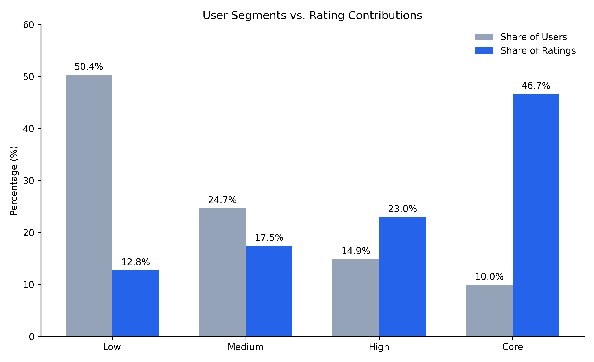
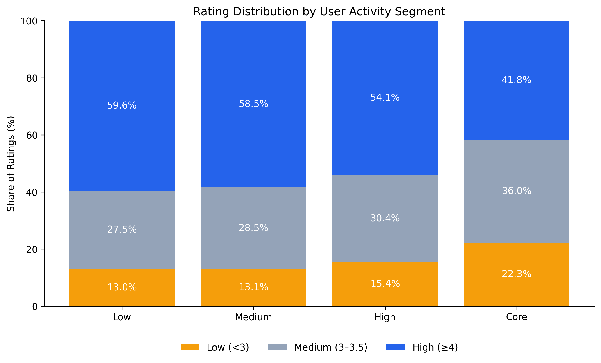
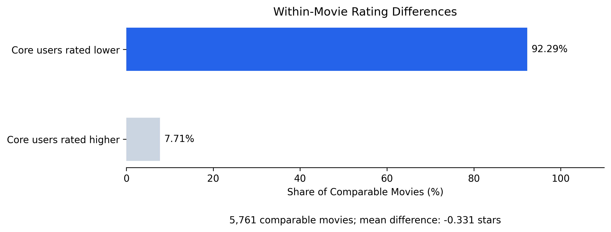

# MovieLens 25M: User Rating Behavior & Content Preference Analysis

## Project Overview

This project analyzes user rating behavior and movie genre patterns
using the MovieLens 25M dataset.

The objective is to identify differences in rating activity,
rating distributions, and genre-level behavior across user segments.

**Tech Stack:** Google BigQuery (SQL), Python, Pandas, Matplotlib

## Dataset

- Source: [GroupLens MovieLens 25M](https://grouplens.org/datasets/movielens/25m/)
- Rating records: 25,000,095
- Users: 162,541
- Movies with ratings: 59,047
- Rating period: January 9, 1995 – November 21, 2019
- Rating scale: 0.5–5.0

The dataset contains explicit movie ratings, not viewing,
impression, click, or purchase records.

MovieLens 25M includes users with at least 20 ratings.
Therefore, the results do not represent all registered users
of a general movie platform.

## Analytical Workflow

1. Imported and validated the MovieLens dataset in BigQuery.
2. Calculated cumulative rating activity for each user.
3. Segmented users into four activity groups using percentile ranks.
4. Measured user shares and rating contribution shares.
5. Analyzed movie genre distributions and average ratings.
6. Compared rating distributions across activity segments.
7. Conducted within-movie comparisons between low-activity
   and core-activity users.
8. Visualized findings using Python.

## Key Findings

### 1. Rating activity is highly concentrated

Core users represent 9.98% of the sample but contribute
46.70% of all rating records.



### 2. Rating distributions differ across user segments

Core users assign ratings of 4.0 or above in 41.79%
of their rating records, compared with 59.56%
among low-activity users.

The overall average rating is 3.368 for core users
and 3.736 for low-activity users.



### 3. Differences persist in within-movie comparisons

For 5,761 movies with at least 20 ratings from each
of the two compared segments:

- Core users have a lower average rating for 92.29% of movies.
- The equal-weight mean difference (Core minus Low)
  is -0.331 rating points.



### 4. Genre-level rating patterns vary

Drama has the highest rating volume, with 10,962,833
genre-associated rating records.

Genre shares also differ between low-activity
and core-activity users. These shares describe rating
behavior rather than observed viewing preferences.

## Potential Business Applications

- Use rating-activity segments to understand differences
  in user feedback contribution.
- Consider user rating tendencies when interpreting
  aggregate movie ratings and recommendation feedback.
- Explore segment-specific content discovery strategies
  as hypotheses for future validation.

These are analytical recommendations, not demonstrated
business improvements or experimentally validated effects.

## Methodological Notes and Limitations

- This is an observational analysis; it does not establish causality.
- User segments are based on cumulative rating counts,
  not current activity or retention.
- Movie genres overlap; one rating can contribute to
  multiple genre categories.
- Within-movie comparisons control for movie identity,
  but not rating time or other user characteristics.
- The 5,761-movie comparison requires at least 20 ratings
  from both low-activity and core-activity users.
- Results may be affected by sample selection
  and self-selection in rating behavior.

## Repository Structure

```text
movielens-user-behavior-analysis/
├── README.md
├── sql/
│   ├── 01_data_validation.sql
│   ├── 02_user_segmentation.sql
│   ├── 03_genre_analysis.sql
│   └── 04_rating_comparison.sql
├── python/
│   └── visualization.py
└── figures/
    ├── user_segment_contribution.png
    ├── rating_distribution_by_segment.png
    └── within_movie_rating_comparison.png
```

## Reproducibility

1. Download MovieLens 25M from GroupLens.
2. Import `ratings.csv` and `movies.csv` into BigQuery.
3. Create the cleaned `ratings` table with fields:
   `user_id`, `movie_id`, `rating`,
   `rating_timestamp`, and `rating_date`.
4. Run the SQL analysis scripts.
5. Run `python/visualization.py` to reproduce the figures.

The visualization script uses aggregated results
obtained from the BigQuery analysis.
Raw MovieLens data is not included in this repository.
